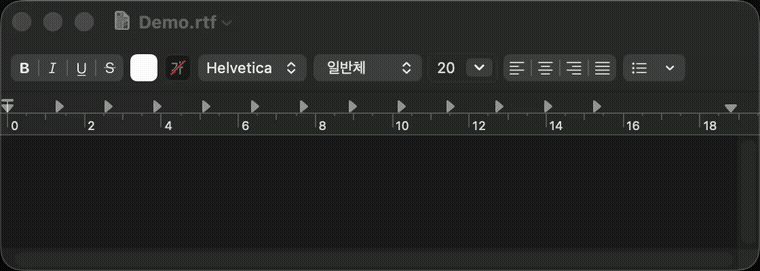
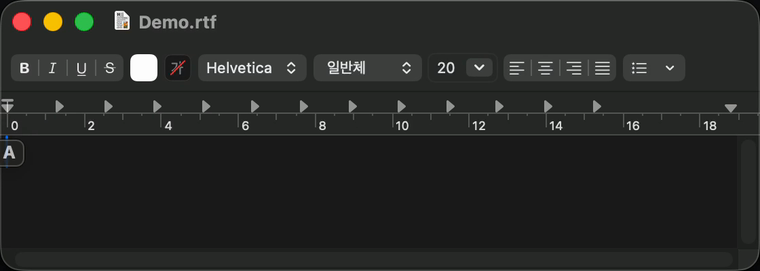
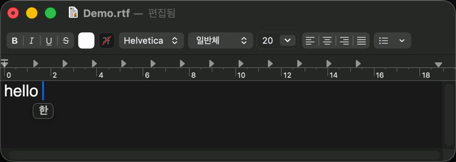
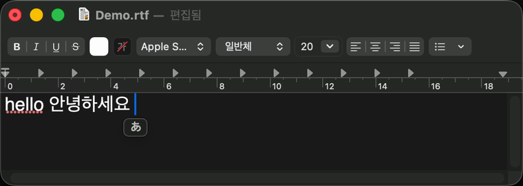

<div align="center">

# 한영 표시기

**지금 한글인지 영문인지, 텍스트 커서 바로 아래에서 알려 주는 macOS·Windows 앱**

[](https://github.com/kgyujin/hanyeong-indicator/releases/latest)
[](https://github.com/kgyujin/hanyeong-indicator/actions/workflows/ci.yml)

[](LICENSE)



[설치](#설치) · [사용법](#사용법) · [동작 방식](#동작-방식) · [개발](#개발)

</div>

입력란을 클릭하고 타이핑을 시작했는데 한/영이 반대로 되어 있던 적이 있다면, 이 앱이 그 첫 글자를 막아 줍니다.
입력란에 들어가는 순간과 입력 언어를 바꾸는 순간에만 커서 아래에 작은 배지를 띄우고, 타이핑을 시작하면 바로 사라집니다.

- **필요할 때만 표시**: 입력란 진입·언어 전환 때 잠깐 뜨고, 타이핑하거나 2초가 지나면 숨김
- **커서 바로 아래**: macOS 기본 입력 소스 표시기와 같은 자리, 같은 회색 모양
- **한·영·일·중 구분**: 한 / A / あ ア ｱ / 简 繁
- **키 입력을 보지 않음**: 전역 키보드 훅 없이 운영체제가 알려 주는 입력기 상태만 읽음
- **가벼움**: 메모리 약 14MB, 대기 CPU 약 0.1% (macOS 실측)

| 영문 | 한글 | 일본어 |
|:---:|:---:|:---:|
|  |  |  |

## 설치

[Node.js](https://nodejs.org) 18 이상이 있으면 한 줄로 설치하고 바로 실행합니다. 같은 명령으로 최신 버전으로 업데이트합니다.

```bash
npx github:kgyujin/hanyeong-indicator
```

git이 없다면(주로 Windows) 릴리스에 올린 설치 묶음을 바로 실행합니다.

```bash
npx https://github.com/kgyujin/hanyeong-indicator/releases/latest/download/hanyeong-indicator.tgz
```

두 명령 모두 npm에 올린 패키지를 쓰지 않습니다. 설치 명령은 GitHub 저장소(또는 릴리스)에서 받고, 앱은 [GitHub 릴리스](https://github.com/kgyujin/hanyeong-indicator/releases)에서 내려받습니다.

| | 설치 위치 |
|---|---|
| macOS | `~/Applications/HanyeongIndicator.app` |
| Windows | `%LOCALAPPDATA%\Programs\HanyeongIndicator\` |

> [!IMPORTANT]
> **macOS**는 처음 실행할 때 "손쉬운 사용" 권한을 묻습니다. 허용해야 커서 위치를 알 수 있습니다.
> 거부하면 입력 언어를 바꿀 때만 마우스 포인터 옆에 배지가 뜹니다.
> 나중에 허용하려면 메뉴바의 한영 표시기 메뉴에서 "손쉬운 사용 권한 허용…"을 누르세요. 업데이트 후에는 권한을 다시 허용해야 할 수 있습니다.

Node.js 없이 설치하려면 [릴리스 페이지](https://github.com/kgyujin/hanyeong-indicator/releases)에서 zip을 받으세요.

<details>
<summary>zip으로 설치하기</summary>

- **macOS** (`…-macos-universal.zip`): 압축을 풀고 앱을 응용 프로그램 폴더로 옮겨 실행합니다.
  "확인되지 않은 개발자" 경고가 뜨면 시스템 설정 > 개인정보 보호 및 보안에서 "그래도 열기"를 누릅니다.
- **Windows** (`…-windows-x64.zip`, `…-windows-arm64.zip`): 압축을 풀고 `hanyeong-indicator.exe`를 실행합니다.
  "Windows의 PC 보호" 창이 뜨면 "추가 정보 > 실행"을 누릅니다.

배포본은 코드 서명을 하지 않아 처음 한 번 위 확인이 필요합니다.

</details>

## 사용법

실행하면 메뉴바(macOS) 또는 알림 영역(Windows)에 현재 입력 모드 글자가 나타납니다. 그 메뉴에서 설정을 바꿉니다.

| 메뉴 | 선택지 | 기본값 |
|---|---|---|
| 표시 방식 | 입력을 시작할 때 잠깐 / 항상 | 입력을 시작할 때 잠깐 |
| 모양 | 시스템 기본(회색) / 언어별 색 | 시스템 기본 |
| 크기 | 작게 / 보통 / 크게 | 보통 |
| 불투명도 | 50% / 70% / 85% / 100% | 85% |
| 위치 | 캐럿 아래 / 캐럿 오른쪽 | 캐럿 아래 |
| 전환할 때 크게 강조 | 켜기 / 끄기 | 끄기 |
| 로그인할 때 자동 실행 | 켜기 / 끄기 | 끄기 |

배지에 나오는 글자는 다음과 같습니다.

| 입력 상태 | 배지 |
|---|:---:|
| 한글 | 한 |
| 영문 (일본어·중국어 입력기 안의 영문 모드 포함) | A |
| 히라가나 / 가타카나 / 반각 가타카나 | あ / ア / ｱ |
| 중국어 간체 / 번체 | 简 / 繁 |
| 그 밖의 언어 | 언어 코드 (예: RU) |
| 읽을 수 없음 (Windows 관리자 권한 창 등) | ? |

설치된 앱을 다시 실행하거나 제거할 때도 같은 명령을 씁니다.

```bash
npx github:kgyujin/hanyeong-indicator start      # 설치된 앱 실행
npx github:kgyujin/hanyeong-indicator uninstall  # 앱과 로그인 시 자동 실행 등록 제거(설정 파일은 남김)
```

## 동작 방식

배지를 띄울 때와 숨길 때는 다음 규칙을 따릅니다.

- **띄움**: 입력란에 커서가 들어간 순간, 입력란 안에서 입력 언어를 바꾼 순간
- **숨김**: 캐럿이 두 글자 이상 움직이면(타이핑 시작) 또는 2초가 지나면
- 입력란이 아닌 곳에서는 띄우지 않습니다.

커서 위치는 다음 순서로 찾습니다. 찾지 못하면 다음 방법으로 넘어갑니다.

| | macOS | Windows |
|---|---|---|
| 입력 언어 | 입력 소스 변경 알림(TIS) | 포커스 창의 IME 변환 모드(100ms 간격 확인) |
| 커서 위치 | 손쉬운 사용 API의 글자 범위 → 텍스트 마커(Chrome·Electron·Firefox) → 입력란 영역 | Win32 캐럿 → UI Automation → 입력란 영역 |
| 마지막 대체 | 마우스 포인터 옆 | 마우스 포인터 옆 |
| 필요한 권한 | 손쉬운 사용 | 없음 |

> [!NOTE]
> 알려진 제한
> - macOS 중국어 병음 입력기 안에서 Shift로 바꾸는 영문 모드는 입력 소스가 바뀌지 않아 简으로 표시됩니다.
> - 타이핑 시작은 키 입력이 아니라 캐럿 이동으로 판단합니다. 화살표 키나 클릭으로 커서를 옮겨도 배지가 사라집니다.
> - 메뉴바에 항목이 많으면 macOS가 한영 표시기 아이콘을 화면 밖으로 밀어낼 수 있습니다.
> - Windows 버전은 실제 기기에서 아직 충분히 확인하지 못했습니다. 문제가 있으면 [이슈](https://github.com/kgyujin/hanyeong-indicator/issues)로 알려 주세요.

## 개발

[Rust](https://rustup.rs) 1.88 이상이 필요합니다.

```bash
cargo run --release                     # 앱 실행 (HANYEONG_DEBUG=1 이면 배지 좌표·판정을 출력)
cargo run --release --bin hanyeong-probe -- --help   # 입력 언어·커서 위치 진단 도구
cargo test
cargo clippy --all-targets --target x86_64-pc-windows-msvc   # macOS에서 Windows 코드 검사
```

| 작업 | 명령 |
|---|---|
| macOS 앱 번들 | `scripts/bundle-macos.sh --universal` → `dist/HanyeongIndicator.app` |
| 설치 묶음 미리 만들기 | `node scripts/npm/stage.mjs --version 0.1.0 --out dist/npm --standalone true` |
| 버전 일치 확인 | `node scripts/npm/check-versions.mjs` |
| README 데모 다시 녹화 | `python3 scripts/demo/record_demo.py` (약 30초 동안 화면을 자동 조작) |

### 릴리스

버전을 올려 `main`에 푸시하면 [Release 워크플로](.github/workflows/release.yml)가 나머지를 처리합니다.
버전은 `Cargo.toml`, `package.json`, `npm/hanyeong-indicator/package.json` 세 곳을 함께 바꿉니다(CI가 일치 여부를 검사).

1. macOS 유니버설 앱과 Windows x64·ARM64 실행 파일을 빌드합니다.
2. `v<버전>` 태그와 GitHub 릴리스를 만들고 zip과 설치 묶음(`hanyeong-indicator.tgz`)을 올립니다.
   이때부터 위의 `npx` 명령이 새 버전을 설치합니다.

> [!TIP]
> npm 레지스트리에도 올리고 싶다면 저장소 비밀값 `NPM_TOKEN`을 등록하세요. 등록돼 있으면 같은 워크플로가
> `hanyeong-indicator`와 OS별 실행 파일 패키지 3개를 npm에 배포해, `npx hanyeong-indicator`로도 설치할 수 있게 됩니다.
